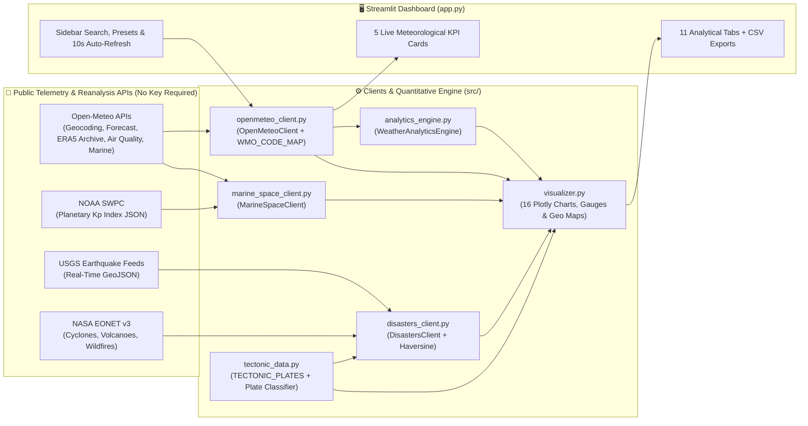

<h1 align="center">🌦️ Weather Intelligence &amp; Quantitative Earth Analytics Platform</h1>

<p align="center">
  <strong>An 11-module Streamlit and Plotly telemetry platform integrating Open-Meteo, ECMWF ERA5 reanalysis, NOAA SWPC space weather, USGS seismic feeds, and NASA EONET satellite hazards — delivering global forecasts, energy degree-day modeling, renewable yield analytics, air quality monitoring, and real-time geohazard tracking with zero API keys required.</strong>
</p>

<p align="center">
  <a href="#-executive-overview"><b>Overview</b></a> •
  <a href="#-analytical-modules-and-dashboard-tabs"><b>Modules</b></a> •
  <a href="#-quantitative-models-and-formulas"><b>Methodology</b></a> •
  <a href="#-system-architecture"><b>Architecture</b></a> •
  <a href="#-repository-structure"><b>Structure</b></a> •
  <a href="#-installation-and-usage"><b>Quickstart</b></a> •
  <a href="#-external-data-providers"><b>Data Feeds</b></a>
</p>

<p align="center">
  
  
  
  
</p>

<p align="center">
  
  
  
  
</p>

---

## 🌐 Executive Overview

**Weather Intelligence & Earth Analytics Platform** consolidates global meteorology, multi-decade climate trend analysis, energy demand modeling, environmental air quality, oceanographic waves, solar geomagnetic activity, agro-meteorology, and global disaster surveillance into one dark-themed dashboard (`app.py`).

Built for meteorologists, energy and commodity analysts, climate researchers, agricultural planners, and situational-awareness engineers, every external endpoint operates over public REST/GeoJSON feeds (**100% free, zero API keys or secrets required**), paired with a 10-second live auto-refresh cycle (`streamlit_autorefresh`) and one-click CSV data exports.

### Location Coverage & Controls
- **Worldwide Geocoding Search**: Resolve any city or coordinate globally via `OpenMeteoClient.search_location()`.
- **8 Built-in Global Hub Presets**: Casablanca, Riyadh, Dubai, New York, London, Paris, Tokyo, and Singapore.
- **Tectonic Classification**: Automatically classifies the selected city's crustal plate via `identify_tectonic_plate()` (`src/tectonic_data.py`).
- **Configurable Horizons**: Adjustable forecast window (`3–16` days, default `14`), historical reanalysis start year (`1950–2020`, default `1980`), and 10-second live refresh toggle.

---

## 🧩 Analytical Modules and Dashboard Tabs

The application (`app.py`) renders **5 live KPI cards** (Current Weather via WMO code decoding, Feels Like, Relative Humidity, Wind Velocity & Gusts, Barometric MSL Pressure) above **11 analytical tabs**:

| Tab | Module | Engine / Client | Outputs & Capabilities |
|---|---|---|---|
| **1** | `🔮 14-Day High-Res Forecast` | `OpenMeteoClient.fetch_forecast` | Dual-axis hourly Temp/Feels-Like/Precipitation chart, 14-day Max/Min diurnal bands, Wind/Gusts vs. MSL Pressure dual-axis plot, raw hourly CSV export. |
| **2** | `⚖️ Multi-City Comparison & Battle` | `OpenMeteoClient` + `create_city_comparison_charts` | Side-by-side City A vs. City B telemetry deltas (Temp, Humidity, Wind, Pressure) and aligned 3-row comparative Plotly subplots. |
| **3** | `🌍 Historical Climate & Warming Trends` | `fetch_historical_climate` + `calculate_climate_warming_trend` | On-demand ECMWF/ERA5 daily archive aggregation (`1950–Present`), OLS warming rate (°C/decade), $R^2$ goodness-of-fit, years analyzed, and trend line plot. |
| **4** | `⚡ Energy Degree Days (HDD / CDD)` | `WeatherAnalyticsEngine.compute_degree_days` | Heating Degree Days (natural gas / heating proxy) and Cooling Degree Days (AC / peak grid load proxy) at $18.0^\circ\text{C}$ base with grouped bar visual. |
| **5** | `☀️ Renewable Energy Potential` | `WeatherAnalyticsEngine.calculate_renewable_potential` | Mean and peak Solar PV Yield Index ($\text{W/m}^2$ with thermal derating) and Wind Power Density ($\text{W/m}^2$) time-series. |
| **6** | `🌿 Air Quality & Environment` | `OpenMeteoClient.fetch_air_quality` | US EPA AQI gauge (`0–300`), US (`0–500`) vs. European (`0–100`) AQI comparison, 6-pollutant load radar (`PM2.5`, `PM10`, `NO₂`, `O₃`, `SO₂`, `CO`), full-series WHO threshold timeline (`PM2.5`, `PM10`, `NO₂`, `O₃`, `SO₂`), health advisory banner, trailing 72h table preview, and CSV export. |
| **7** | `🌊 Marine & Ocean Meteorology` | `MarineSpaceClient.fetch_marine_weather` | Significant wave height, swell wave height, wind wave height, and wave/swell periods for coastal coordinates (with graceful inland notice). |
| **8** | `☀️ Space Weather & Solar Storms (NOAA)` | `MarineSpaceClient.fetch_space_weather` | Real-time NOAA Planetary $K_p$ index gauge (`0–9`), `G0–G5` geomagnetic storm classification, aurora visibility advisory, recent $K_p$ trend chart, and NOAA scale table. |
| **9** | `🌾 Agro-Meteorology & Soil Intelligence` | `OpenMeteoClient.fetch_forecast` + `create_soil_moisture_chart` | Multi-depth soil moisture stratification (`0–1 cm`, `1–3 cm`, `3–9 cm`, `9–27 cm`), FAO-56 Penman-Monteith cumulative $ET_0$ ($\text{mm}$), and Vapor Pressure Deficit ($\text{kPa}$). |
| **10** | `🚨 Anomaly & Extreme Weather (Z-Score)` | `WeatherAnalyticsEngine.detect_temperature_anomalies` | Rolling 7-day Z-score over `temperature_2m_max` flagging heatwaves and cold snaps ($|Z| \ge 1.5$). |
| **11** | `🌋 Geohazards, Earthquakes & Crustal Plates` | `DisastersClient` + `tectonic_data.py` | USGS Earthquake feeds (`all_week`, `all_day`, `4.5_month`, `significant_month`) with `M 2.5–7.0` filter, tsunami flags, NASA EONET cyclones/volcanoes/wildfires, 8 tectonic plate fault overlays, Haversine Proximity Risk Radar (`top_n=8`), and Magnitude vs. Depth scatter plot. |

---

## 📐 Quantitative Models and Formulas

All analytical calculations reside in `src/analytics_engine.py` and `src/disasters_client.py`:

1. **Energy Degree Days** (`compute_degree_days`, $T_{\text{base}} = 18.0^\circ\text{C}$):
   $$\text{HDD} = \max(0,\ 18.0 - T_{\text{mean}}), \qquad \text{CDD} = \max(0,\ T_{\text{mean}} - 18.0)$$

2. **Solar PV Thermal-Derated Index** (`calculate_renewable_potential`):
   $$I_{\text{PV}} = \max\!\left(0,\ \text{DNI} \cdot \left[1 - \max\!\left(0,\ 0.004 \cdot (T_{2\text{m}} - 25.0)\right)\right]\right) \quad \left[\text{W/m}^2\right]$$
   Applies a $-0.4\%/^\circ\text{C}$ silicon panel efficiency derating above $25^\circ\text{C}$ to Direct Normal Irradiance ($\text{DNI}$).

3. **Wind Kinetic Power Density** (`calculate_renewable_potential`, air density $\rho = 1.225\ \text{kg/m}^3$, $v_{\text{m/s}} = v_{\text{km/h}} / 3.6$):
   $$P_{\text{wind}} = \frac{1}{2}\,\rho\,v_{\text{m/s}}^3 \quad \left[\text{W/m}^2\right]$$

4. **Multi-Decade OLS Climate Warming Trend** (`calculate_climate_warming_trend`):
   Aggregates daily reanalysis into annual mean temperatures and fits ordinary least squares (`scipy.stats.linregress`) over `Year` vs. `mean_temp_c` to compute the decadal warming slope ($10 \cdot \hat{\beta}_1$ in $^\circ\text{C}/\text{decade}$), coefficient of determination ($R^2$), and two-sided $p$-value.

5. **Rolling Statistical Temperature Anomalies** (`detect_temperature_anomalies`):
   $$Z_t = \frac{T_t - \mu_{\text{roll}, t}}{\sigma_{\text{roll}, t}}$$
   Computed in Tab 10 using a 7-day rolling window (`window=7`, `min_periods=7`) with global fallback for short series, flagging anomaly regimes at $|Z| \ge 1.5$ and $|Z| \ge 2.0$.

6. **Geohazard Great-Circle Proximity** (`haversine_distance_km`, $R = 6371.0\ \text{km}$):
   $$a = \sin^2\!\left(\frac{\Delta\phi}{2}\right) + \cos(\phi_1)\cos(\phi_2)\sin^2\!\left(\frac{\Delta\lambda}{2}\right), \qquad d = 2R\operatorname{atan2}\!\left(\sqrt{a},\sqrt{1-a}\right)$$

---

## 🏗️ System Architecture



---

## 📂 Repository Structure

```text
weather-intelligence-app/
├── src/
│   ├── __init__.py                   # Package initialization
│   ├── analytics_engine.py           # HDD/CDD, Z-score anomalies, solar/wind potential & OLS climate trends
│   ├── disasters_client.py           # USGS earthquake feeds, NASA EONET v3 events & Haversine proximity radar
│   ├── marine_space_client.py        # Open-Meteo Marine wave/swell & NOAA SWPC Planetary Kp client
│   ├── openmeteo_client.py           # Open-Meteo Geocoding, Forecast, ERA5 Archive, Air Quality & WMO decoder
│   ├── tectonic_data.py              # 8 crustal plate boundary polygons & coordinate plate classifier
│   └── visualizer.py                 # 16 Plotly charts, gauges, polar pollutant radar & global hazard maps
├── .gitattributes                    # Git LF line-ending normalization
├── .gitignore                        # Python, venv, and .env ignore rules
├── app.py                            # Main Streamlit application (11 interactive modules)
├── LICENSE                           # Apache License 2.0
├── README.md                         # Project documentation
└── requirements.txt                  # Python package dependencies
```

---

## 🚀 Installation and Usage

### Prerequisites
- **Python**: `3.10` or higher.
- **Internet Connection**: Required to query Open-Meteo, NOAA SWPC, USGS, and NASA EONET live feeds.

### 1. Clone the Repository
```bash
git clone https://github.com/khalid-naami/weather-intelligence-app.git
cd weather-intelligence-app
```

### 2. Create & Activate a Virtual Environment
```powershell
# Windows PowerShell
python -m venv .venv
.\.venv\Scripts\Activate.ps1
```

```bash
# macOS / Linux
python3 -m venv .venv
source .venv/bin/activate
```

### 3. Install Dependencies
```bash
pip install -r requirements.txt
```
Dependencies in `requirements.txt`: `streamlit>=1.30.0`, `pandas>=2.0.0`, `numpy>=1.24.0`, `requests>=2.31.0`, `plotly>=5.18.0`, `scipy>=1.11.0`, `streamlit-autorefresh>=1.0.1`.

### 4. Launch the Dashboard
```bash
streamlit run app.py
```
Open `http://localhost:8501` in your browser. No `.env` file or API credentials are needed.

---

## 📡 External Data Providers

| Provider | Endpoints Used | Coverage / Cadence |
|---|---|---|
| **Open-Meteo** | `geocoding-api`, `api.open-meteo.com/v1/forecast`, `archive-api` (ECMWF ERA5), `air-quality-api`, `marine-api` | Global geocoding, 1–16 day hourly/daily weather & soil models, 1950–Present climate archive, AQI/pollutants, ocean waves & swell. |
| **NOAA SWPC** | `services.swpc.noaa.gov/products/noaa-planetary-k-index.json` | Real-time Planetary $K_p$ index and geomagnetic storm scale (`G0–G5`). |
| **USGS Earthquake Hazards** | `earthquake.usgs.gov/earthquakes/feed/v1.0/summary/{all_day,all_week,4.5_month,significant_month}.geojson` | Global seismic events, focal depths, Richter magnitudes, and tsunami alert flags. |
| **NASA EONET v3** | `eonet.gsfc.nasa.gov/api/v3/events` | Satellite-tracked severe storms/cyclones, active volcanoes, and wildfires over trailing 30-day windows. |

---

## ⚠️ Analytical Notice & License

- **Disclaimer**: Meteorological, oceanographic, air-quality, space-weather, and geohazard telemetry is presented for analytical, research, and informational visualization only. Always consult official national meteorological agencies, civil protection authorities, and tsunami/aviation warning centers for life-safety decisions.
- **License**: Licensed under the **Apache License, Version 2.0** — see [LICENSE](LICENSE) for full details.
